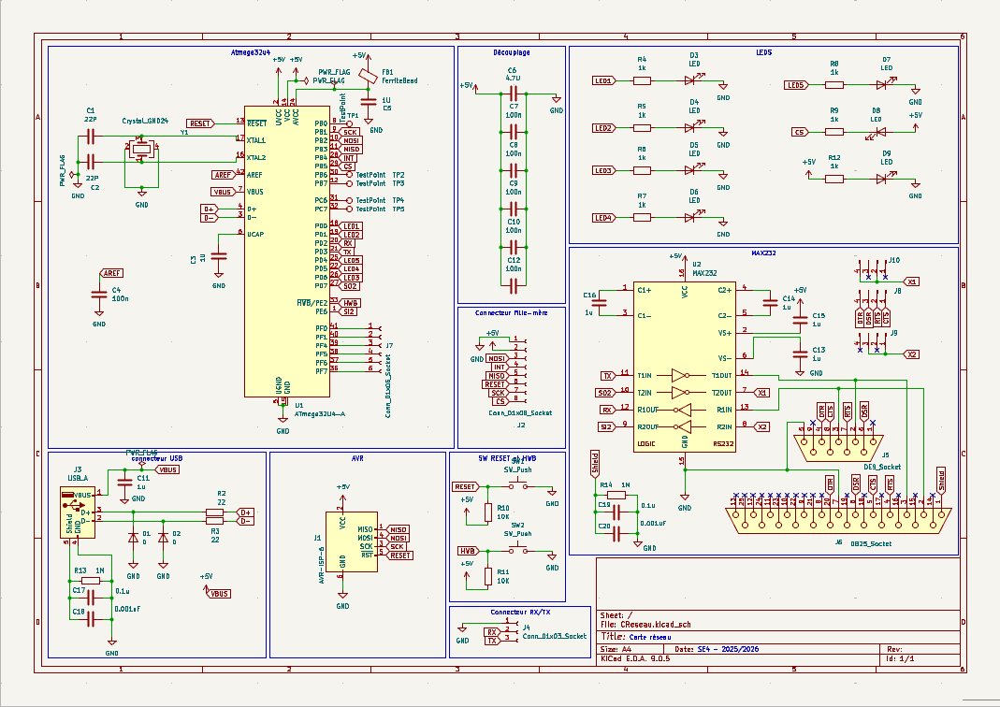
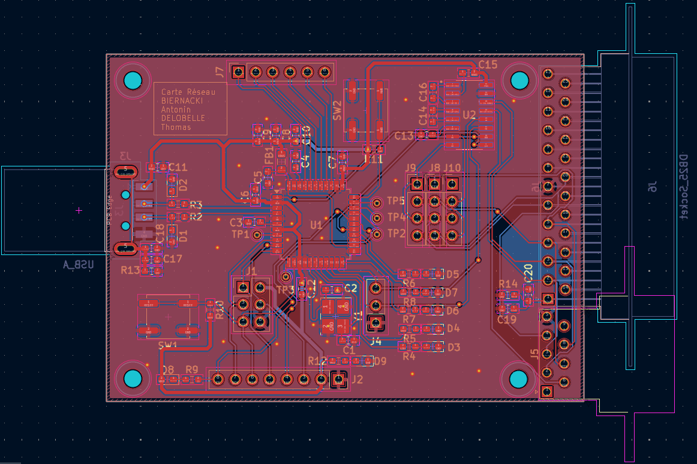

# Carte réseau USB pour ATmega32U4

Carte réseau USB conçue sous **KiCad**, construite autour d'un **ATmega**. Elle se présente comme une interface Ethernet (classe **RNDIS**, via la bibliothèque LUFA) et doit permettre à une carte mère de lire, écrire et lister des fichiers sur un PC, grâce à un protocole maison transporté en UDP : le **ProtocolAntique**. Un serveur C côté PC traite les requêtes.

> **État du projet** : ce dépôt est un état d'avancement. Le projet n'a pas été mené à son terme, voir [Avancement](#avancement).

## Sommaire

- [Contexte](#contexte)
- [Avancement](#avancement)
- [Aperçu](#aperçu)
- [Fonctionnalités](#fonctionnalités)
- [Structure du projet](#structure-du-projet)
- [Matériel](#matériel)
- [Compilation et téléversement](#compilation-et-téléversement)
- [Utilisation](#utilisation)
- [Fonctionnement interne](#fonctionnement-interne)
- [Crédits](#crédits)

## Contexte

L'idée est la suivante :

1. la carte mère exprime un besoin (`ls`, `read`, `write`) à la carte réseau ;
2. la carte réseau encapsule ce besoin dans une requête UDP (ProtocolAntique) et l'envoie au PC par l'USB ;
3. un serveur tourne sur le PC, exécute l'opération sur son système de fichiers et répond.

## Avancement

| Élément                                                             | État      |
|---------------------------------------------------------------------|-----------|
| Schématique et routage de la carte, soudage                         | Terminé   |
| Programmation de la carte et pilotage des LEDs                      | Terminé   |
| Reconnaissance de la carte comme interface réseau USB (RNDIS), `ping` | Terminé   |
| Réception de trames Ethernet et de paquets UDP (signalée par LED)   | Terminé   |
| Envoi d'une trame UDP depuis la carte (capturée avec Wireshark)     | Terminé   |
| Spécification du ProtocolAntique                                    | Terminé   |
| Serveur PC (`ls`, `read`, `write`) et ses outils de test            | Terminé et testé |
| Traitement des requêtes ProtocolAntique par la carte                | À faire   |
| Liaison avec la carte mère (shield), par SPI                        | À faire   |

Faute de temps, la carte n'a pas été reliée à la carte mère. La communication SPI a toutefois été validée lors du développement de l'ordonnanceur.

## Aperçu

### Schématique



### Routage



## Fonctionnalités

- Énumération USB de la carte comme interface Ethernet (RNDIS)
- Réception et traitement de trames Ethernet, avec indication par LED
- Envoi d'une trame UDP de test contenant une requête ProtocolAntique
- Protocole applicatif maison (ProtocolAntique) à trois opérations : `LS`, `READ`, `WRITE`
- Serveur PC UDP qui exécute ces opérations sur le système de fichiers
- Outils de simulation pour tester le serveur sans la carte (client de requêtes et faux récepteur)

## Structure du projet

```text
.
├── docs/                              # Captures et vidéos de démonstration
├── hardware/                          # Projet KiCad de la carte réseau
└── software/
    ├── CReseau/
    │   ├── test.c                     # Test autonome des LEDs de la carte
    │   └── Makefile
    ├── lufa-LUFA-210130-NSI/
    │   └── PicoCReseau/RNDISEthernet/ # Firmware de la carte (basé sur la démo RNDIS de LUFA)
    │       ├── RNDISEthernet.c        # main, tâches USB/RNDIS, envoi de la trame de test
    │       ├── Config/AppConfig.h     # Adresses IP et MAC
    │       ├── Lib/UDP.c              # Aiguillage des paquets UDP par port
    │       ├── Lib/ProtocolAntique.c  # Traitement du ProtocolAntique
    │       ├── Lib/ProtocolAntique.h  # En-tête et codes d'opération
    │       └── makefile
    └── serveurProtocolAntique/
        ├── serveur/                   # Serveur PC (reçoit et traite les requêtes)
        ├── testUDP/                   # Outils de simulation (client et faux récepteur)
        ├── descriptionProtocol.txt    # Description du ProtocolAntique
        ├── fonctionnement.txt         # Mode d'emploi du serveur et des tests
        └── Makefile
```

Le dossier `software/testUDP/` est une version antérieure des outils de test, conservée telle quelle.

## Matériel

La carte est construite autour d'un **ATmega** (USB natif, horloge à 16 MHz) et comprend :

- 5 LEDs d'état de communication, une LED d'alimentation et une LED de connexion ISP
- un **MAX232** avec des connecteurs **DB9** et **DB25**, pour utiliser la carte sur un terminal série
- un connecteur 6x1 qui expose les broches `PF` inutilisées, pour réutiliser la carte dans d'autres projets
- un connecteur USB, par lequel elle se présente au PC

Affectation des broches utilisées par le logiciel :

| Élément          | Broche |
|------------------|--------|
| LED 1            | PD0    |
| LED 2            | PD1    |
| LED 3            | PD6    |
| LED 4            | PD5    |
| LED 5            | PD4    |
| Ligne CS (test)  | PB5    |

Rôle des LEDs dans le firmware :

| LED                | Signification                                              |
|--------------------|------------------------------------------------------------|
| LED 1              | Allumée pendant le traitement d'une trame Ethernet reçue   |
| LED 4 et LED 5     | Allumées à la réception d'un paquet UDP sur le port 3333   |

Les LEDs sont éteintes à la fin du traitement de chaque trame.

## Compilation et téléversement

Les outils nécessaires sont `avr-gcc`, `make`, `dfu-programmer` (carte) et `gcc` (serveur).

### Firmware de la carte

Depuis `software/lufa-LUFA-210130-NSI/PicoCReseau/RNDISEthernet/` :

```bash
make          # produit RNDISEthernet.hex
make dfu      # téléverse sur la carte (ATmega32U4 en mode DFU)
make clean
```

### Test des LEDs

Depuis `software/CReseau/` :

```bash
make          # produit test.hex
make flash    # téléverse en DFU
make clean
```

### Serveur PC et outils de test

Depuis `software/serveurProtocolAntique/` :

```bash
make          # compile serveur, testUDP et serveur_carte
make clean
```

## Utilisation

### Avec la carte

Branche la carte en USB, puis configure l'interface réseau qu'elle crée (`eth2` dans notre cas, vérifie son nom avec `ip link`) :

```bash
sudo ip link set eth2 up
sudo ip address add 10.0.0.1/24 dev eth2
ping 10.0.0.2
```

La carte a l'adresse `10.0.0.2` ; la configuration des adresses IP et MAC se trouve dans `Config/AppConfig.h`. Les paquets échangés peuvent être observés avec Wireshark sur l'interface de la carte.

### Serveur PC

Lance le serveur depuis `software/serveurProtocolAntique/` :

```bash
./serveur/serveur
```

Il écoute en UDP sur le port **4242** et traite chaque requête reçue.

### Test du serveur sans la carte

Les requêtes de la carte sont simulées en loopback, dans trois terminaux :

```bash
./serveur/serveur                      # 1. le serveur (port 4242)
./testUDP/serveur_carte                # 2. faux récepteur qui joue la carte (port 5000)
./testUDP/testUDP ls <chemin>          # 3. requêtes simulées
./testUDP/testUDP read <chemin/fichier>
./testUDP/testUDP write <chemin/fichier> <ligne 1> ... <ligne n>
```

Sans chemin, `ls` liste le dossier depuis lequel le serveur a été lancé. Les fichiers créés avec `write` ne sont pas supprimés par `make clean` : à supprimer à la main.

Exemple de session de test : un `ls` (8 entrées, soit 9 réponses avec le message de fin), un `write` de 3 lignes dans `test.txt` (1 réponse de fin d'écriture) puis un `read` de ce fichier (5 lignes, soit 6 réponses avec le message de fin).

## Fonctionnement interne

### Côté carte

- **Interface réseau USB** : le firmware est la démo RNDIS de LUFA. La carte apparaît comme une carte Ethernet, les trames reçues sont placées dans un tampon (`FrameIN`) et celles à émettre dans un autre (`FrameOUT`).
- **Boucle principale** : elle enchaîne `Ethernet_Task()` (traitement des trames reçues), l'envoi de la trame de test (`SendRawEthernetPacket()`), `RNDIS_Task()` et `USB_USBTask()`.
- **Trame de test** : `SendRawEthernetPacket()` copie dans `FrameOUT` une trame complète (en-têtes Ethernet, IP, UDP) qui contient une requête `LS` à destination du port 3333.
- **Aiguillage UDP** : `Lib/UDP.c` oriente les paquets selon leur port de destination. Le port **3333** est celui du ProtocolAntique (supérieur à 1023 pour ne pas exiger les droits root) et est transmis à `ProtocolAntique_ProcessProtocolAntiquePacket()`.

### ProtocolAntique

Chaque message UDP contient un en-tête de 3 octets suivi du contenu, pour 256 octets au maximum :

| Octet | Champ       | Rôle                                                                                      |
|-------|-------------|-------------------------------------------------------------------------------------------|
| 0     | `operation` | Type de message                                                                           |
| 1     | `longueur`  | Nombre d'octets du contenu (0 à 252)                                                      |
| 2     | `numero`    | 0 pour une requête ; dans une réponse fragmentée, numéro du paquet (0 = dernier paquet) |

Opérations :

| Code   | Sens             | Message                      | Contenu                                    |
|--------|------------------|------------------------------|--------------------------------------------|
| `0x01` | carte → serveur  | Requête `LS`                 | chemin du dossier (vide = dossier courant) |
| `0x11` | serveur → carte  | Réponse `LS`                 | un nom d'entrée par message                |
| `0x02` | carte → serveur  | Requête `READ`               | chemin/nom du fichier                      |
| `0x12` | serveur → carte  | Réponse `READ`               | une ligne du fichier par message           |
| `0x03` | carte → serveur  | `WRITE` (début)              | chemin/nom du fichier                      |
| `0x13` | carte → serveur  | `WRITE` (données et fin)     | une ligne à écrire ; `numero` 0 = fin      |
| `0x23` | serveur → carte  | Réponse `WRITE`              | `0x00` si tout s'est bien passé, `0x01` si une erreur est survenue |

Une réponse fragmentée se termine toujours par un message de longueur 0 et de numéro 0.

### Côté serveur

- **Boucle de réception** : `boucleServeurUDP()` reçoit chaque message sur le port 4242 et le passe à `traitementMessageUDP()`. Les messages dont la longueur ne correspond pas à l'en-tête sont rejetés.
- **`LS`** : ouvre le dossier avec `opendir`, puis envoie un message de réponse par entrée (`readdir`), suivi du message de fin.
- **`READ`** : ouvre le fichier avec `fopen`, envoie une réponse par ligne (`fgets`), puis le message de fin si la lecture est allée jusqu'au bout.
- **`WRITE`** : mémorise le chemin reçu dans le message de début, puis ajoute chaque ligne au fichier. Le serveur vérifie que les numéros se suivent pour détecter un paquet perdu. Le message de fin déclenche la réponse `0x23`, avec un code de réussite ou d'erreur.
- **Réponses** : elles sont envoyées par `messageUDP()` à `IP_LOOPBACK` sur le port `PORT_CARTE` (5000), ce qui correspond au mode simulation. Pour répondre à la vraie carte, ces constantes sont à adapter dans `serveur.h` (`IP_CARTE` vaut `10.0.0.2`).

## Crédits

- Thomas Delobelle
